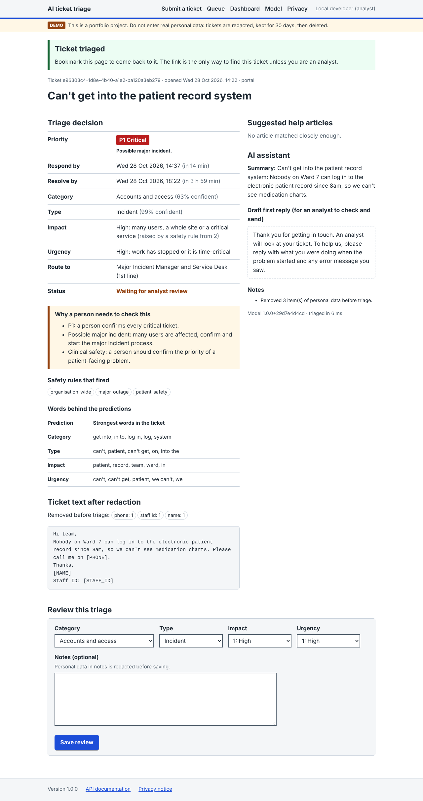
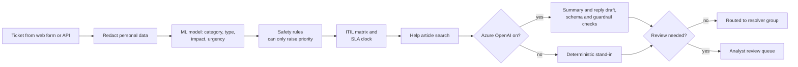
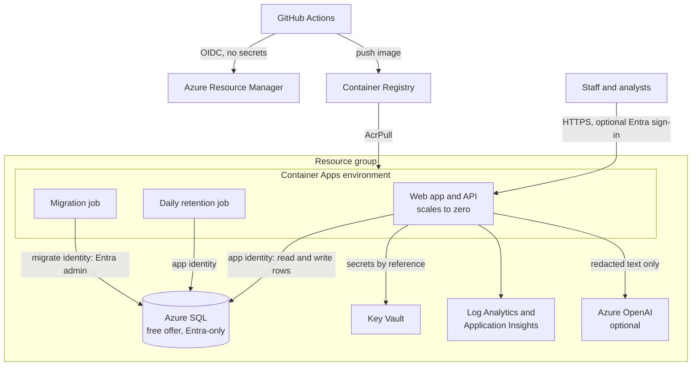
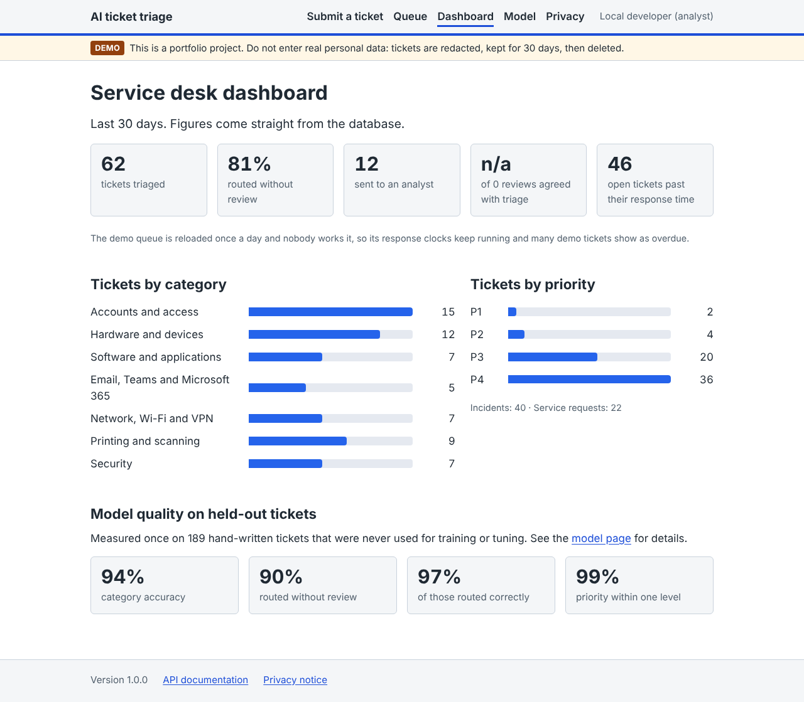
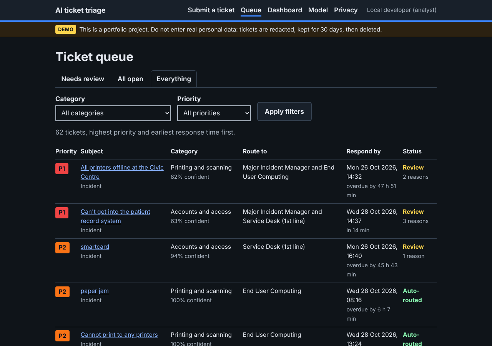
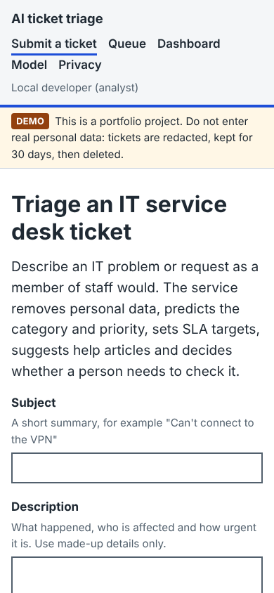

# AI ticket triage

[](https://github.com/AbelYonathan-max/ai-ticket-triage/actions/workflows/ci.yml)
[](https://github.com/AbelYonathan-max/ai-ticket-triage/actions/workflows/deploy.yml)

An IT service desk tool that reads a support ticket and does the first-line triage: it removes
personal data, decides the category and whether it is an incident or a service request, sets the
ITIL priority and SLA deadlines, spots possible major incidents, suggests help articles and drafts a
first reply. Anything uncertain or high-risk goes to a person.

It runs on Azure Container Apps with Azure SQL, and is deployed by Terraform from GitHub Actions
with no stored passwords or keys.



## What it does

- **Removes personal data first.** Names, emails, phone numbers, NHS and National Insurance numbers,
  card numbers, postcodes, staff IDs, IP addresses and passwords are replaced with tags such as
  `[PHONE]` before anything else sees the text. Only the redacted text is stored.
- **Classifies the ticket** into 7 categories (accounts, hardware, software, Microsoft 365, network,
  printing, security), incident or service request, and impact and urgency on the ITIL 1 to 3 scales.
  Each prediction shows the words that drove it.
- **Sets the priority with the ITIL impact and urgency matrix**, then applies 10 safety rules that can
  only raise it: a phishing link that was clicked, ransomware, a lost laptop, personal data sent to the
  wrong person, a patient-facing system down, a whole site affected, and so on.
- **Works out the SLA deadlines** on a service desk clock: P1 runs around the clock, P2 to P4 count
  business hours only and skip England and Wales bank holidays. The targets live in
  [`sla.yaml`](src/triage/config/sla.yaml).
- **Sends tickets to a person** when the model is unsure, when it is P1, when it might be a major
  incident or a clinical safety problem, or when the ticket looks like a prompt injection attempt.
- **Suggests help articles** from a small knowledge base, and only when they match well.
- **Drafts a summary and a first reply** with Azure OpenAI, if switched on. The model is an
  assistant, never the decision maker: it cannot set the priority, its output is checked against a
  strict schema and guardrails, and it only ever sees redacted text.
- **Analyst review** of every triage, a queue, a dashboard, an audit log and a JSON API with
  OpenAPI docs.

## Results

Measured once on **189 hand-written tickets** that were kept apart from training and tuning
(details in the [model card](docs/model-card.md)):

| | Result |
|---|---|
| Category accuracy (7 classes) | 93.7% (majority-class baseline: 14.3%) |
| Incident or service request | 96.8% |
| Tickets routed without review | 90.0%, and 97.1% of those went to the right team |
| Priority exactly right | 83.1% |
| Priority within one level | 98.9% |
| Under-prioritised | 5.3% (7.9% without the safety rules) |
| Critical (P1) tickets rated P1 | 3 of 4 |
| Time to triage a ticket | a few milliseconds, without the language model |

Urgency is the hardest part (73% accuracy): people describe the same problem with very different
levels of alarm. That is why P1 and possible major incidents always go to a person.

## How it works



The model is TF-IDF features with logistic regression, one classifier per output. It was chosen
over a language model on purpose: it is fast, cheap, explains itself, gives calibrated confidence for
the review threshold, and is retrained in under a minute from the data in this repository. The
training data is 8,400 synthetic tickets from a generator with UK public sector vocabulary, plus 92
hand-written tickets for tuning; the 189 test tickets were written separately. See
[ADR 1](docs/adr/0001-classic-ml-for-triage.md).

## Architecture on Azure



- **No passwords anywhere.** GitHub signs in to Azure with OpenID Connect. The app and the jobs use
  managed identities for the registry, Key Vault, Azure SQL and Azure OpenAI. SQL has Microsoft Entra
  authentication only, and Azure OpenAI has API keys switched off.
- **Least privilege.** The web app's identity can read and write rows but cannot change the schema;
  a separate migration identity is the database admin and is used only by the migration job. The
  deploy identity is Contributor on one resource group and may only grant five named roles there.
- **Secrets stay out of Terraform state.** The analyst key and session secret are generated as
  ephemeral values and written to Key Vault with write-only arguments.
- **Low running cost.** The app scales to zero, the database uses the Azure SQL free offer, and logs
  are capped. Expect about £4 a month, almost all for the container registry. See
  [cost](docs/cost.md).

More in [architecture](docs/architecture.md).

## Security and privacy

- [Data protection impact assessment](docs/dpia.md) (UK GDPR)
- [Threat model](docs/threat-model.md): STRIDE, and the OWASP Top 10 for LLM applications
- [Runbook](docs/runbook.md): deploys, rollbacks, secret rotation, alerts and incidents
- [ITIL mapping](docs/itil.md) and the [labelling guide](docs/labelling-guide.md)

Web security: a strict Content Security Policy with no inline scripts or styles, signed CSRF tokens,
HTTP security headers, rate limiting, signed session cookies, an audit log without ticket text, and
tickets deleted after 30 days.

## Screenshots

| Dashboard | Queue in dark mode | Phone |
|---|---|---|
|  |  |  |

The pages are server-rendered HTML with no JavaScript, keyboard accessible with a skip link, and
work at phone width and in dark mode.

## Run it locally

You need Python 3.12 or later.

```bash
python -m venv .venv && source .venv/bin/activate   # Windows: .venv\Scripts\activate
make install    # or: pip install -e ".[dev]"
make train      # generate the synthetic data, train and evaluate (about a minute)
make run        # http://127.0.0.1:8000, SQLite, demo tickets, no sign-in needed locally
```

`make test` runs the tests. To run against SQL Server instead of SQLite, as in Azure:

```bash
docker compose up --build    # app on http://127.0.0.1:8000 with SQL Server 2022
```

The API documentation is at `/docs`. A ticket by API:

```bash
curl -s -X POST http://127.0.0.1:8000/api/v1/triage -H 'content-type: application/json' \
  -d '{"subject": "VPN keeps dropping", "body": "The VPN disconnects every few minutes at home."}'
```

## Deploy to Azure

You need an Azure subscription where you are Owner, and a copy of this repository on GitHub.

1. Open [Azure Cloud Shell](https://shell.azure.com) in Bash and run, with your repository name:

   ```bash
   git clone https://github.com/OWNER/REPO.git && bash REPO/infra/bootstrap/bootstrap.sh OWNER/REPO
   ```

   The script creates the resource groups, the Terraform state storage and the deploy identity,
   then asks you to sign in to GitHub once so it can set the repository variables and start the
   first deploy. It does not store any secret in GitHub. Read
   [what it does](infra/bootstrap/bootstrap.sh) first.

2. The **Deploy** workflow then runs Terraform, builds and pushes the image, runs the database
   migration and smoke-tests the live app. After that, every push to `main` that passes CI deploys.

3. Sign in as an analyst with the key from Key Vault:

   ```bash
   az keyvault secret show --vault-name <key_vault_name> -n analyst-api-key --query value -o tsv
   ```

   or with your Microsoft account, if the script could switch on Entra sign-in.

Optional switches, as repository variables: `ENABLE_OPENAI=true` for the Azure OpenAI assistant
(pay per use, capped by a daily token budget), `ENABLE_BUDGET=true` for a monthly cost budget.

## Project layout

```text
src/triage/
  api/          FastAPI app, JSON API and web routes
  data/         synthetic ticket generator
  db/           SQLAlchemy models, Alembic migrations, Azure SQL token sign-in
  domain/       taxonomy, ITIL matrix and SLA clock, safety rules
  jobs/         migration and retention jobs
  kb/           help articles and retrieval
  llm/          Azure OpenAI provider, prompts, guardrails, stand-in
  ml/           features, training, evaluation, model card
  privacy/      personal data redaction
  security/     sign-in, sessions, CSRF, headers, rate limiting
  web/          templates and CSS
data/test/      hand-written dev and test tickets
infra/          Terraform, Terraform tests and the bootstrap script
docs/           model card, architecture, ADRs, DPIA, threat model, runbook
```

## Limitations

- The training data is synthetic and the dev and test tickets were written for this project, not
  taken from a real service desk. Real tickets will be messier, so the review threshold should be
  re-checked on a sample of real, redacted tickets before relying on it.
- Redaction is rule-based. It catches the common UK formats and tested edge cases, but it can miss
  unusual personal data, which is why the data is kept for 30 days only and the app tells people not
  to enter real personal data.
- The test set has only 4 P1 tickets, so the P1 figure is indicative rather than precise.
- English only.
- The public demo uses one shared analyst key unless Entra sign-in is on.

## Licence

[MIT](LICENSE)
