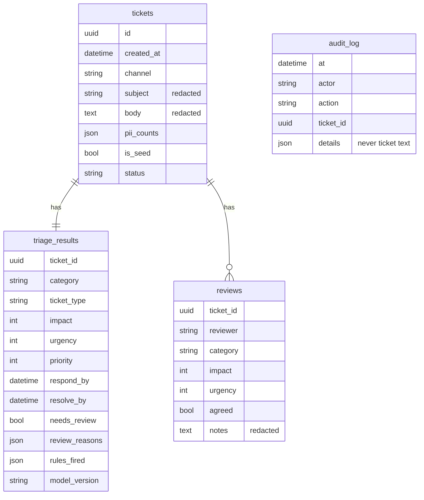
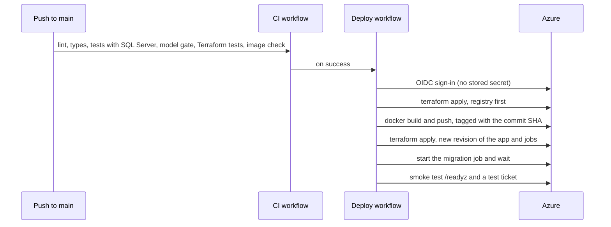

# Architecture

## Request flow

A ticket arrives from the web form (`POST /submit`) or the API (`POST /api/v1/triage`). Everything
below happens in one request, in this order, in [`service.py`](../src/triage/service.py):

1. **Redaction** ([`privacy/redact.py`](../src/triage/privacy/redact.py)). Personal data is replaced
   with tags. Nothing later in the pipeline, including the database and the language model, ever
   sees the original text.
2. **Classification** ([`ml/model.py`](../src/triage/ml/model.py)). Four logistic regression heads
   on shared TF-IDF features (word 1-2 grams and character 3-5 grams) predict category, type, impact
   and urgency, each with a probability and the strongest terms behind it.
3. **Safety rules** ([`domain/rules.py`](../src/triage/domain/rules.py)). Ten deterministic rules
   look for patterns that must never be under-prioritised. They can raise impact or urgency, never
   lower them, and some add review reasons.
4. **Priority and SLA** ([`domain/itil.py`](../src/triage/domain/itil.py)). The ITIL impact by
   urgency matrix gives P1 to P4. The SLA clock turns the targets in
   [`sla.yaml`](../src/triage/config/sla.yaml) into respond-by and resolve-by times.
5. **Help articles** ([`kb/retrieve.py`](../src/triage/kb/retrieve.py)). TF-IDF search over the
   Markdown articles, restricted to the predicted category unless another category matches strongly.
6. **Assistant** ([`llm/`](../src/triage/llm/)). With Azure OpenAI on, the redacted ticket and the
   matched articles go to the model, which must answer in a strict JSON schema. The answer is then
   checked by guardrails. A circuit breaker and a daily token budget stop runaway cost or a failing
   service from blocking triage: on any problem the ticket is triaged without the assistant.
7. **Review gate.** The ticket goes to an analyst when category confidence is below 0.60, type
   confidence is below 0.60, it is P1, a rule marks it as a possible major incident or a clinical
   safety problem, the urgency model gives a real chance that work has stopped although the urgency
   was set lower, or the assistant flags something (such as a possible prompt injection).
8. **Storage** ([`db/`](../src/triage/db/)). The redacted ticket, the triage result and an audit
   event are written in one transaction.

## Data model

Migrations are Alembic scripts in [`db/migrations`](../src/triage/db/migrations/). The same schema
runs on SQLite (local and tests) and Azure SQL (CI runs the tests against SQL Server 2022 too).

## Identities and permissions

| Identity | Used by | Can do | Cannot do |
|---|---|---|---|
| `id-…-app` (managed identity) | Web app, retention job | Read and write rows (`db_datareader`, `db_datawriter`); read two Key Vault secrets; pull images; call Azure OpenAI deployments | Change the schema; grant permissions; manage Azure resources |
| `id-…-migrate` (managed identity) | Migration job only | SQL Entra admin: run migrations, create the app's database user | Anything outside SQL; it is not reachable from the web app |
| `id-triage-github` (managed identity, federated with GitHub) | Deploy workflow | Contributor on the app resource group; grant only AcrPull, AcrPush, Key Vault Secrets User, Key Vault Secrets Officer and Cognitive Services OpenAI User there; write Terraform state | Anything outside the resource group; grant Owner or any other role |
| Analyst | People reviewing tickets | Review tickets, see the full queue | Change configuration |

The app identity's database user is created by the migration job with
`CREATE USER … WITH SID = …, TYPE = E`, from the identity's client ID, so the SQL server needs no
Microsoft Graph permissions to look identities up.

## Deployment pipeline

The image trains the model inside the build from the data in this repository, with fixed seeds,
so a commit always produces the same model version.

## Health checks

- `/healthz` checks only the process. Container Apps uses it for start-up, liveness and readiness,
  so a paused free-offer database can never make the platform restart the app.
- `/readyz` also checks the database connection and that the schema is at the expected migration.
  The deploy smoke test uses it.

## Configuration

All settings are environment variables prefixed `TRIAGE_`, read by
[`settings.py`](../src/triage/settings.py). In production the app refuses to start without sign-in
configured, and Easy Auth headers are trusted only when `TRIAGE_TRUST_EASY_AUTH_HEADERS` is set,
which Terraform does only when Container Apps authentication is on.

## Decisions

- [ADR 1: classic machine learning for triage](adr/0001-classic-ml-for-triage.md)
- [ADR 2: the language model assists, it never decides](adr/0002-llm-assists-never-decides.md)
- [ADR 3: Container Apps and the Azure SQL free offer](adr/0003-container-apps-and-sql-free-offer.md)
- [ADR 4: no secrets, managed identities everywhere](adr/0004-no-secrets-managed-identities.md)
