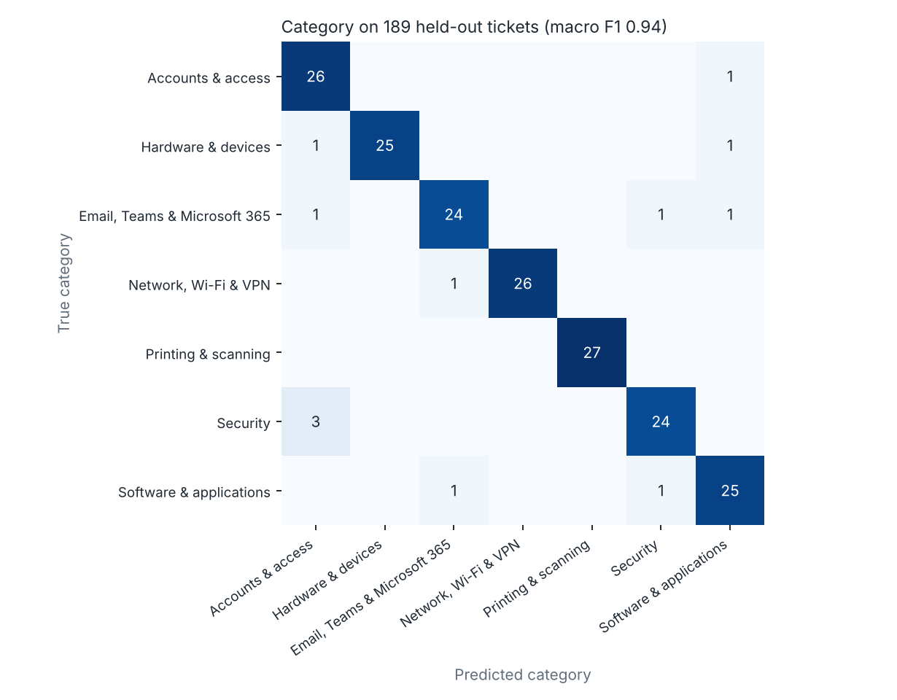
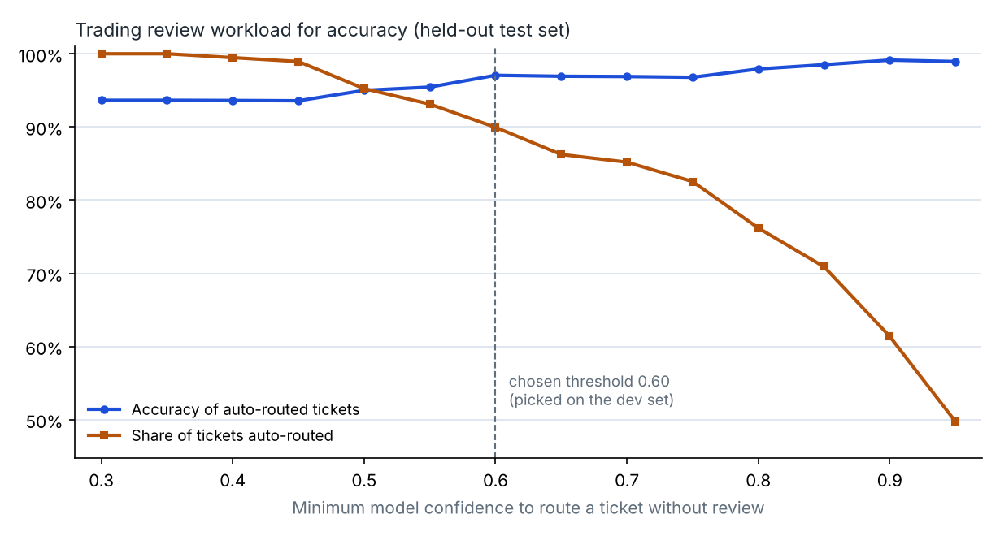

# Model card

<!-- BEGIN GENERATED METRICS -->
Model `1.0.0+29d7e4d4cd` (logistic regression), evaluated once on **189 held-out tickets** that were written separately from the training data and never used for training or tuning.

| Output | Accuracy | Macro F1 | Majority-class baseline |
|---|---|---|---|
| Category (7 classes) | 93.7% | 0.937 | 14.3% |
| Incident or service request | 96.8% | 0.965 | 64.0% |
| Impact (3 levels) | 91.0% | 0.820 | 84.1% |
| Urgency (3 levels) | 73.0% | 0.732 | 41.3% |

**Priority (P1 to P4)** after the safety rules: 83.1% exactly right, 98.9% within one level, 5.3% under-prioritised (model alone: 7.9%). P1 recall: 75.0% with rules, 75.0% without.

**Human review:** tickets whose category confidence is below 0.60 go to an analyst. At that threshold 90.0% of test tickets were routed automatically and 97.1% of those were routed to the right team; the model was right on 63.2% of the ones sent for review.

**Effect of the 92 realistic dev tickets:** a model trained on synthetic tickets alone scores category macro F1 0.932 and urgency 0.721 on the same test set, against 0.937 and 0.732 for the final model.

Per category (test set):

| Category | Precision | Recall | F1 | Tickets |
|---|---|---|---|---|
| Accounts and access | 0.84 | 0.96 | 0.90 | 27 |
| Hardware and devices | 1.00 | 0.93 | 0.96 | 27 |
| Email, Teams and Microsoft 365 | 0.92 | 0.89 | 0.91 | 27 |
| Network, Wi-Fi and VPN | 1.00 | 0.96 | 0.98 | 27 |
| Printing and scanning | 1.00 | 1.00 | 1.00 | 27 |
| Security | 0.92 | 0.89 | 0.91 | 27 |
| Software and applications | 0.89 | 0.93 | 0.91 | 27 |

Model selection on the dev set (macro F1, trained on synthetic data only):

| Algorithm | Category | Type | Impact | Urgency |
|---|---|---|---|---|
| logistic regression | 0.967 | 0.956 | 0.903 | 0.772 |
| linear svm calibrated | 0.967 | 0.970 | 0.898 | 0.743 |
| complement naive bayes | 0.923 | 0.926 | 0.728 | 0.670 |

<!-- END GENERATED METRICS -->
