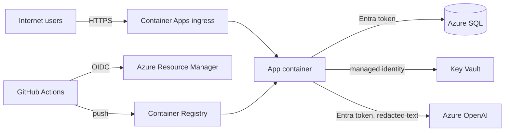

# Threat model

Scope: the service as deployed by this repository on Azure, its pipeline and the optional Azure
OpenAI assistant. Method: STRIDE per trust boundary, then the OWASP Top 10 for LLM Applications
(2025).

## Assets

1. Ticket text and triage results (personal data, possibly special category data).
2. Correct priorities: a wrong low priority delays urgent help.
3. The analyst key, the session-signing secret and analyst sessions.
4. The Azure subscription: the deploy identity and the managed identities.
5. The source code and the pipeline, which decide what runs in production.
6. Cost: the language model and Azure resources are billed by use.

## Trust boundaries

Boundaries: internet to ingress; app to each Azure service; GitHub to Azure; the ticket text to the
language model (untrusted input crossing into a prompt).

## STRIDE

| Threat | Example | Mitigations | Residual |
|---|---|---|---|
| **Spoofing** an analyst | Guessing or stealing the analyst key or a session | Long random key from Key Vault, compared in constant time; HMAC-signed, HttpOnly, Secure, SameSite session cookie with an 8-hour lifetime; optional Entra ID sign-in with an allow-list of object IDs; rate limiting | One shared key in apikey mode; Entra mode recommended for real use |
| **Spoofing** Easy Auth headers | Sending `X-MS-CLIENT-PRINCIPAL-ID` directly | Headers trusted only when `TRIAGE_TRUST_EASY_AUTH_HEADERS` is set, which Terraform does only when Container Apps authentication (which overwrites these headers) is on; the app refuses to start in production with easyauth mode and no trust setting | Low |
| **Spoofing** the pipeline | A fork or another repository deploying | The federated credential trusts only `repo:OWNER/REPO:environment:production`; workflows from pull requests cannot reach that environment's token | Low |
| **Tampering** with requests | Cross-site request forgery on review or login forms | Signed double-submit CSRF tokens on every form; SameSite cookies | Low |
| **Tampering** with the database | SQL injection | SQLAlchemy with bound parameters everywhere; the only dynamic SQL (creating the app's database user) validates the name against a strict pattern and parses the client ID as a GUID | Low |
| **Tampering** with the schema | A compromised web app altering tables | The web app's identity has `db_datareader` and `db_datawriter` only; only the migration job's identity can change the schema | Low |
| **Tampering** with the image | Pushing a malicious image | Registry admin user off; push only by the deploy identity; images tagged with the commit SHA; the app pulls with its own identity | Low |
| **Repudiation** | An analyst denies changing a triage | Audit log of submissions, reviews and sign-ins with the actor and time, kept with the ticket | Shared key mode cannot tell analysts apart |
| **Information disclosure** of tickets | Enumerating ticket pages | Ticket IDs are random UUIDs; queue and dashboard detail are for analysts only; pages are `noindex` and `/tickets/` is disallowed in robots.txt | Anyone with a ticket link can read that redacted ticket, by design |
| **Information disclosure** of personal data | Data in storage, logs or the model prompt | Redaction before storage and before the language model; logs carry no ticket text; 30-day retention; TLS 1.2 or later everywhere | Redaction can miss unusual data (see the DPIA) |
| **Information disclosure** of secrets | Secrets in code, logs, state or CI | No secrets in the repository or GitHub; Key Vault references; write-only Terraform secrets; Key Vault RBAC; masked throwaway password for the CI database container | Low |
| **Information disclosure** via headers or errors | Stack traces, server banners | Generic error pages; `--no-server-header`; security headers (CSP, HSTS, X-Content-Type-Options, Referrer-Policy, Permissions-Policy, frame-ancestors none) | Low |
| **Denial of service** | Flooding the triage endpoint | Per-client rate limit; request body size limit; Container Apps scales out to a capped maximum; the language model has a daily token budget and a circuit breaker | No WAF; a determined attacker could exhaust the rate limit or the free database allowance |
| **Denial of service** by cost | Running up the bill | Max replicas capped; database free offer pauses instead of billing; log ingestion capped; budget alert | Low |
| **Elevation of privilege** in Azure | The deploy identity granting itself Owner | Contributor on one resource group only; it may grant only five named roles, enforced by an Azure ABAC condition; no subscription-wide rights | Low |
| **Elevation of privilege** in the container | Breaking out of the app | Runs as a non-root user (uid 10001) in a slim image; no shell access is exposed | Low |

## OWASP Top 10 for LLM Applications (2025)

Applies only when Azure OpenAI is switched on.

| Risk | How it applies | Mitigations |
|---|---|---|
| LLM01 Prompt injection | Ticket text is untrusted and goes into the prompt | The model has no tools and cannot set priority; ticket text is passed as a JSON value, not as instructions; injection patterns are detected on input and output, and such tickets have their draft withheld and go to a person |
| LLM02 Sensitive information disclosure | Personal data in tickets | Only redacted text is sent; leftover redaction tags in a draft cause it to be withheld; the prompt holds nothing secret |
| LLM03 Supply chain | Model and library provenance | Microsoft-hosted model pinned by name and version, upgraded only when the version expires; Python dependencies checked with pip-audit and kept current by Dependabot |
| LLM04 Data and model poisoning | Training data | The classifier is trained only from data in this repository, reviewed in pull requests; the language model is not fine-tuned |
| LLM05 Improper output handling | Model text rendered in the browser | Output must match a strict JSON schema; values are length-clipped and HTML-escaped by the templates; the CSP blocks inline scripts |
| LLM06 Excessive agency | The model acting on its own | No tools, no actions; the reply is a draft that an analyst reads before sending |
| LLM07 System prompt leakage | Prompt revealing internals | The system prompt contains no secrets or access rules, so leaking it has no impact |
| LLM08 Vector and embedding weaknesses | Retrieval of help articles | Retrieval uses a fixed, reviewed set of articles in the repository; the model may cite only the articles it was given, other citations are removed |
| LLM09 Misinformation | Wrong advice in a draft | Drafts claiming a fix was done or asking for credentials are withheld; drafts are grounded in approved articles and reviewed by an analyst |
| LLM10 Unbounded consumption | Cost and latency | Daily token budget, maximum output tokens, request timeout, circuit breaker, rate limit, and triage that completes without the model |

## Accepted risks and upgrade paths

| Accepted for the demo | Upgrade for production |
|---|---|
| SQL server reachable from Azure services (token still required) | Container Apps in a virtual network, private endpoint for SQL and Key Vault |
| Shared analyst key | Entra ID sign-in (`ENABLE_EASY_AUTH=true`) with app roles |
| Key Vault purge protection off, so the demo can be torn down and rebuilt | Purge protection on |
| No web application firewall | Azure Front Door with WAF |
| No container image vulnerability scan in CI: the widely used Trivy GitHub Action was compromised in March 2026 (CVE-2026-33634), so it was left out rather than added unpinned | Microsoft Defender for Containers on the registry, or a scanner pinned by digest |
| In-memory rate limiting, per replica | Rate limiting at the edge (Front Door) |
